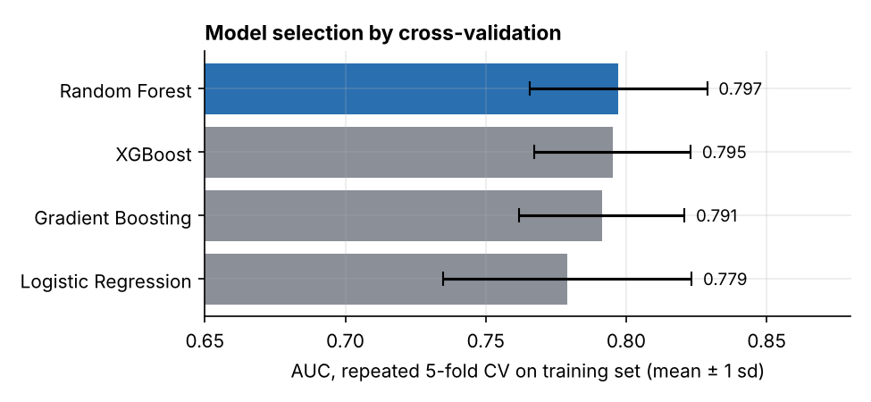
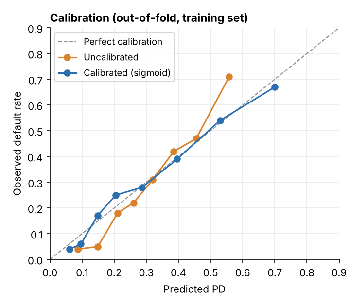
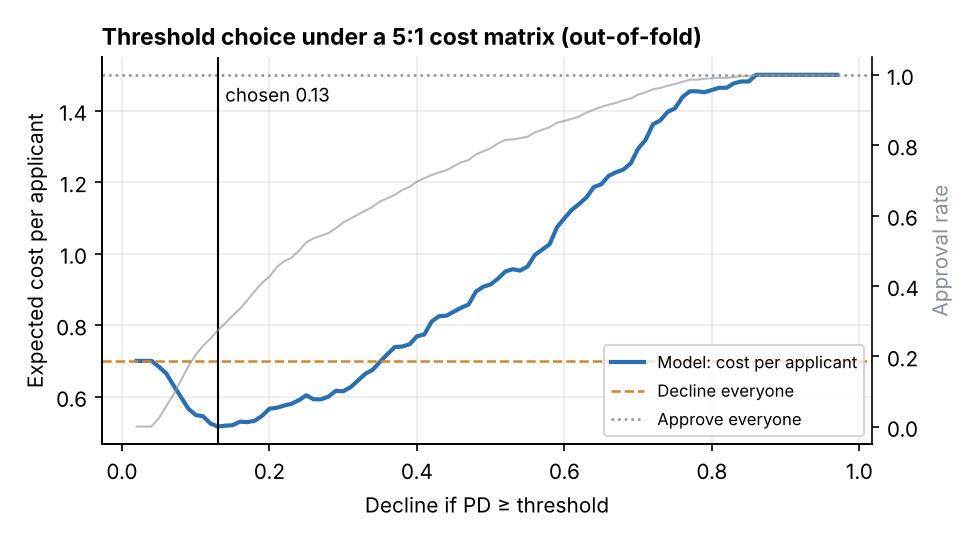
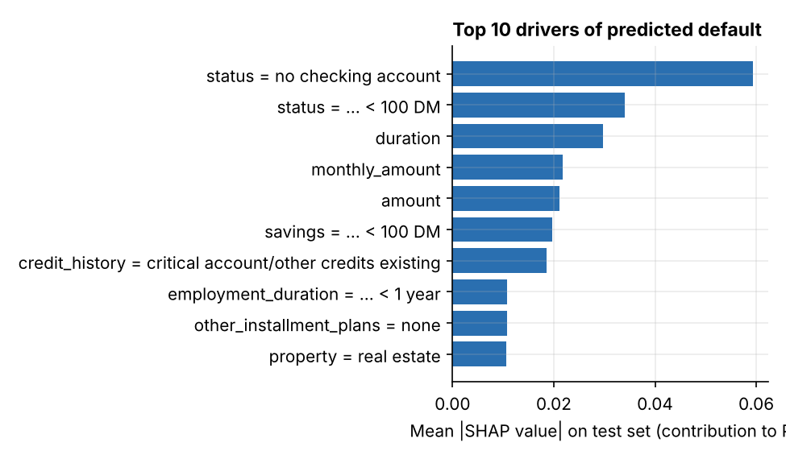

# Retail Credit Risk: Calibrated Probability-of-Default Scoring Service


A probability-of-default (PD) model for retail loans on the Statlog (German Credit) dataset, served as a FastAPI service with SHAP explanations. The focus is on the parts that matter when a PD is used for decisions: honest model selection, calibrated probabilities, and a decision threshold set by an explicit cost function.

## TL;DR

- **Model selected by cross-validation, not by the test set.** Four models were compared by repeated 5-fold CV AUC on the training data. Random Forest ranked first (0.797), but the top three are within one standard deviation of each other.
- **Calibrated PDs.** Platt scaling was selected by out-of-fold Brier score. On the held-out test set, the Brier score is **0.154**, versus 0.210 for predicting the base rate.
- **Cost-based decisions.** With the Statlog cost matrix (approving a defaulter costs 5, declining a good borrower costs 1), the threshold chosen on training data is PD ≥ 0.13. On the test set this cuts expected cost by **21%** against the best trivial policy (declining everyone), while approving 30% of applicants.
- **Test set used once**: AUC **0.807**, Gini 0.61, KS 0.51.

## Results

All numbers come from `python train_model.py`, which writes [`reports/metrics.json`](reports/metrics.json) and the figures below. Stratified 80/20 split, 1,000 obligors, 30% default rate.

### 1. Model selection (training set only)

| Model | CV AUC (mean ± sd, 5-fold × 3 repeats) |
|---|---|
| **Random Forest (selected)** | **0.797 ± 0.032** |
| XGBoost | 0.795 ± 0.028 |
| Gradient Boosting | 0.791 ± 0.030 |
| Logistic Regression | 0.779 ± 0.044 |



With only 800 training rows, the differences are not significant. A logistic regression scorecard would be a defensible choice too, and easier to explain to a regulator. The test set was not used for this choice.

### 2. Calibration

A PD of 20% should mean that about 20% of such borrowers default. Raw Random Forest scores are compressed towards the middle. Platt (sigmoid) scaling had the lowest out-of-fold Brier score (0.1614, versus 0.1620 for isotonic and 0.1668 uncalibrated).



### 3. Decision threshold

Approve if PD < t. Under the 5:1 cost matrix, the theoretical optimum for perfectly calibrated PDs is t = 1/(1+5) ≈ 0.167. The threshold minimising cost on out-of-fold training predictions is **0.13**, close to that value.



Results on the held-out test set:

| Policy | Cost per applicant | Approval rate |
|---|---|---|
| Approve everyone | 1.500 | 100% |
| Decline everyone | 0.700 | 0% |
| **Model, PD < 0.13** | **0.555** | **29.5%** |

Default rate among approved applicants: 8.5% (versus 30% overall).

The 5:1 ratio is the dataset's convention, not a fact about any bank, so the decision is sensitive to it:

| Cost ratio (bad approved : good declined) | Threshold | Approval rate | Saving vs best trivial policy |
|---|---|---|---|
| 2:1 | 0.30 | 56.5% | 42.5% |
| 3:1 | 0.27 | 53.0% | 41.4% |
| 5:1 | 0.13 | 29.5% | 20.7% |
| 8:1 | 0.13 | 29.5% | 10.0% |

At 5:1 or more, declining is cheap relative to a default, so the model mostly identifies a small group of very safe borrowers.

> **Correction to an earlier version:** an earlier version of this README reported a "cost-optimal" threshold of about 0.01 and a cost reduction from 240 to 140. On a 200-applicant test set with 140 good borrowers, a cost of 140 is exactly the cost of declining everyone, so that "optimum" rejected every applicant. The threshold was also tuned on the test set. Both issues are fixed above.

### 4. What drives the predictions



Checking-account status, loan duration and size, and savings dominate. Two effects run the opposite way to intuition, and the raw data confirms them:

| Category | Default rate | n |
|---|---|---|
| status = no checking account | 11.7% | 394 |
| status = ... < 100 DM | 49.3% | 274 |
| credit_history = critical account/other credits existing | 17.1% | 293 |
| credit_history = existing credits paid back duly till now | 31.9% | 530 |

"No checking account" is the *lowest*-risk status group, and a "critical account" history is *lower* risk than a clean one. The usual explanation is selection: applicants with a weak history who were still granted a loan had to pass stricter screening. This is a reminder that SHAP explains the model, not causality.

## Project structure

| File | Role |
|---|---|
| `credit_model.py` | Data, features, candidate models, CV selection, calibration, threshold, prediction, SHAP |
| `report.py` | Figures in `docs/` and `reports/metrics.json` |
| `train_model.py` | Trains, saves `artifacts/credit_risk_model.joblib`, writes the report |
| `api.py` | FastAPI service: `/predict`, `/explain`, `/categories`, `/health` |
| `tests/` | Model-logic tests (cost function, threshold, split) and API tests |

## Quick start

```bash
python -m venv .venv && source .venv/bin/activate
pip install -r requirements.txt
python train_model.py          # ~2 min: CV, calibration, figures
uvicorn api:app --port 8000    # docs at http://localhost:8000/docs
pytest
```

Or with Docker:

```bash
docker build -t credit-risk . && docker run -p 8000:8000 credit-risk
```

## API

`POST /predict` takes the 20 Statlog attributes. `GET /categories` lists the allowed labels for each categorical field.

```bash
curl -X POST http://localhost:8000/predict -H "Content-Type: application/json" -d '{
  "status": "... < 100 DM", "duration": 6, "credit_history": "critical account/other credits existing",
  "purpose": "domestic appliances", "amount": 1169, "savings": "unknown/no savings account",
  "employment_duration": "... >= 7 years", "installment_rate": 4, "personal_status_sex": "male : single",
  "other_debtors": "none", "present_residence": 4, "property": "real estate", "age": 67,
  "other_installment_plans": "none", "housing": "own", "number_credits": 2,
  "job": "skilled employee/official", "people_liable": 1, "telephone": "yes", "foreign_worker": "yes"
}'
```

```json
{"probability_default": 0.074, "rating_grade": "B", "decision": "approve", "decision_threshold": 0.13}
```

`GET /explain?user_id=0` returns the three largest risk-increasing and risk-reducing SHAP contributions for an applicant in the dataset. A label like `status ≠ no checking account` means that the applicant does *not* have that attribute, and its absence raises the PD.

Rating grades on the calibrated PD: A < 5%, B 5–10%, C 10–20%, D 20–35%, E ≥ 35%.

## Limitations

- 1,000 observations from 1970s–80s Germany. The CV spread (±0.03 AUC) is as large as the gap between models.
- PDs are through-the-cycle: there are no macroeconomic variables and no time dimension, so there is no out-of-time validation.
- The cost matrix is illustrative. A real one would come from LGD, EAD and the margin lost on declined borrowers.
- Sensitive attributes (`personal_status_sex`, `foreign_worker`, `age`) are kept to stay comparable with the literature. A production model would need a fairness review and would likely drop them.
- No drift monitoring (e.g. PSI) is implemented.

## References

- Hofmann, H. (1994). *Statlog (German Credit Data)*. UCI Machine Learning Repository.
- Platt, J. (1999). Probabilistic outputs for support vector machines.
- Lundberg, S. & Lee, S.-I. (2017). A unified approach to interpreting model predictions (SHAP).
- Basel Committee on Banking Supervision (2017). *Basel III: Finalising post-crisis reforms.*
